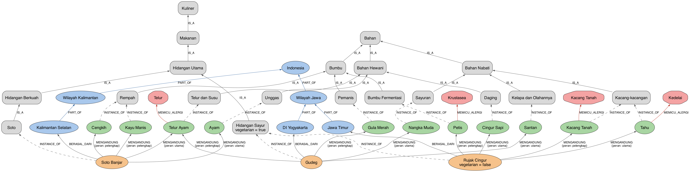
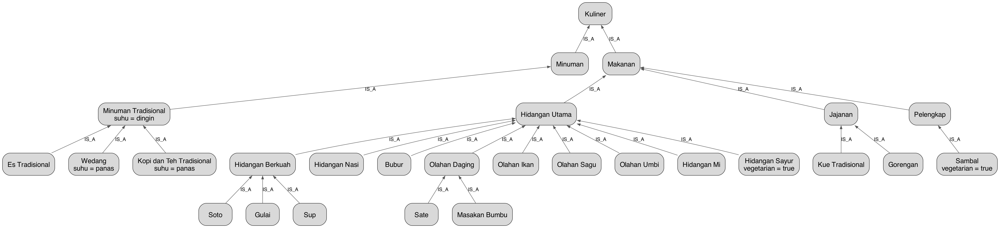
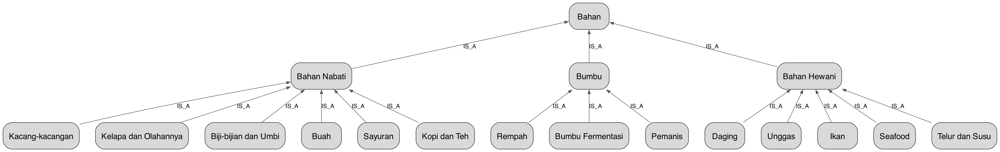
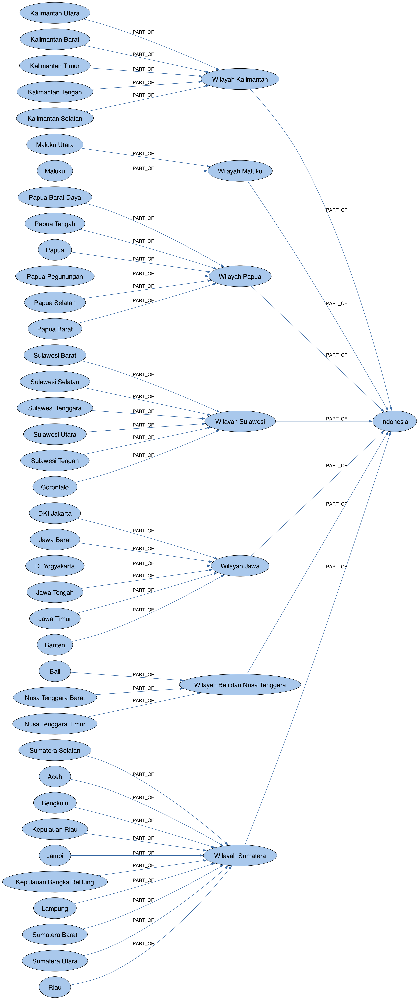
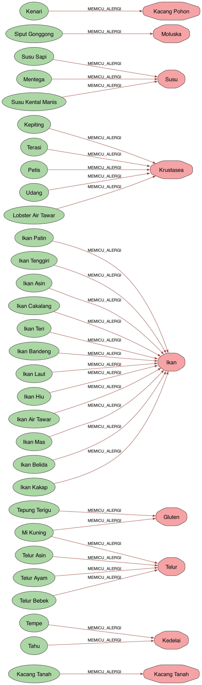

# Kuliner Nusantara Knowledge Graph

Knowledge graph berbasis **Neo4j** yang memodelkan kuliner tradisional Indonesia: hidangan, bahan penyusun, daerah asal, dan alergen. Proyek ini dibuat untuk tugas mata kuliah Rekayasa Sistem Berbasis Pengetahuan.

Isi graf:
- **80 hidangan** dari seluruh **38 provinsi**
- **84 bahan** dan **9 alergen**
- Hierarki kelas sampai **4 level** (Soto → Hidangan Berkuah → Hidangan Utama → Makanan → Kuliner)
- Total **264 node** dan **604 relationship**

Tipe relationship: `IS_A`, `INSTANCE_OF`, `PART_OF`, `BERASAL_DARI`, `MENGANDUNG {peran}`, `MEMICU_ALERGI`.

## Struktur Folder

```
KulinerNusantaraGraph/
├── database_setup/
│   ├── kuliner_v1_unwind_merge.cypher   # Script utama: membangun graf dengan UNWIND + MERGE
│   └── kuliner_v2_create.cypher         # Versi alternatif: CREATE satu per satu
├── query/
│   └── 1_query.cypher ... 8_query.cypher # Pertanyaan dan query Cypher
└── images/                               # Visualisasi graf (PNG, SVG, PDF)
```

| Folder / File | Fungsi |
|---|---|
| `database_setup/kuliner_v1_unwind_merge.cypher` | Membangun seluruh graf dari database kosong. Memakai `MERGE`, jadi aman dijalankan ulang tanpa duplikasi. |
| `database_setup/kuliner_v2_create.cypher` | Isi graf sama, ditulis dengan `CREATE` satu per satu. Hanya untuk database kosong dan dijalankan sekali. |
| `query/` | Delapan pertanyaan beserta query-nya: query dasar, inheritance `IS_A`, transitivity `PART_OF*`, pola, serta `SET` dan `DETACH DELETE`. |
| `images/` | Diagram semantic network dan potongan graf per tema, dibuat dengan Graphviz. |

## Cara Menjalankan

1. Jalankan Neo4j, lalu buka Neo4j Browser di `http://localhost:7474`.
2. Salin seluruh isi `database_setup/kuliner_v1_unwind_merge.cypher` ke editor, lalu jalankan.
3. Cek hasilnya:
   ```cypher
   MATCH ()-[r]->() RETURN type(r) AS tipe, count(r) AS jumlah ORDER BY jumlah DESC;
   ```
4. Jalankan query di folder `query/` sesuai urutan.

## Visualisasi

### Semantic Network
Potongan graf untuk Soto Banjar, Gudeg, dan Rujak Cingur. Diagram ini memuat semua jenis elemen: hierarki kelas, instance, daerah, bahan, alergen, serta default (`Hidangan Sayur: vegetarian = true`) dan exception (`Rujak Cingur: vegetarian = false`).



### Hierarki Kelas Hidangan


### Hierarki Kelas Bahan


### Struktur Wilayah (PART_OF)


### Bahan dan Alergen


## Contoh Query

**Inheritance (IS_A):** hidangan berkuah selain sup
```cypher
MATCH (h:Hidangan)-[:INSTANCE_OF]->(k:KelasHidangan)-[:IS_A*1..3]->(u:KelasHidangan {nama: 'Hidangan Berkuah'})
MATCH (h)-[:BERASAL_DARI]->(p:Provinsi)
WHERE k.nama <> 'Sup'
RETURN DISTINCT h.nama AS hidangan, p.nama AS provinsi, k.nama AS jenis
ORDER BY hidangan;
```

**Transitivity (PART_OF\*):** provinsi di Sumatera dengan hidangan terbanyak
```cypher
MATCH (h:Hidangan)-[:BERASAL_DARI]->(p:Provinsi)-[:PART_OF*1..]->(:Wilayah {nama: 'Wilayah Sumatera'})
RETURN p.nama AS provinsi, count(DISTINCT h) AS jumlah
ORDER BY jumlah DESC;
```

**Pola:** hidangan yang mengandung alergen ikan
```cypher
MATCH (h:Hidangan)-[r:MENGANDUNG]->(b:Bahan)-[:MEMICU_ALERGI]->(:Alergen {nama: 'Ikan'})
RETURN DISTINCT h.nama AS hidangan, b.nama AS bahan, r.peran AS peran
ORDER BY hidangan;
```

**SET dan DETACH DELETE:** perbarui lalu hapus hidangan Seblak (lengkapnya di `query/8_query.cypher`)
```cypher
MATCH (s:Hidangan {nama: 'Seblak'})
SET s.tingkat_pedas = 5, s.catatan = 'Khas Bandung, level pedas bisa dipilih'
RETURN s;

MATCH (s:Hidangan {nama: 'Seblak'})
DETACH DELETE s;
```
